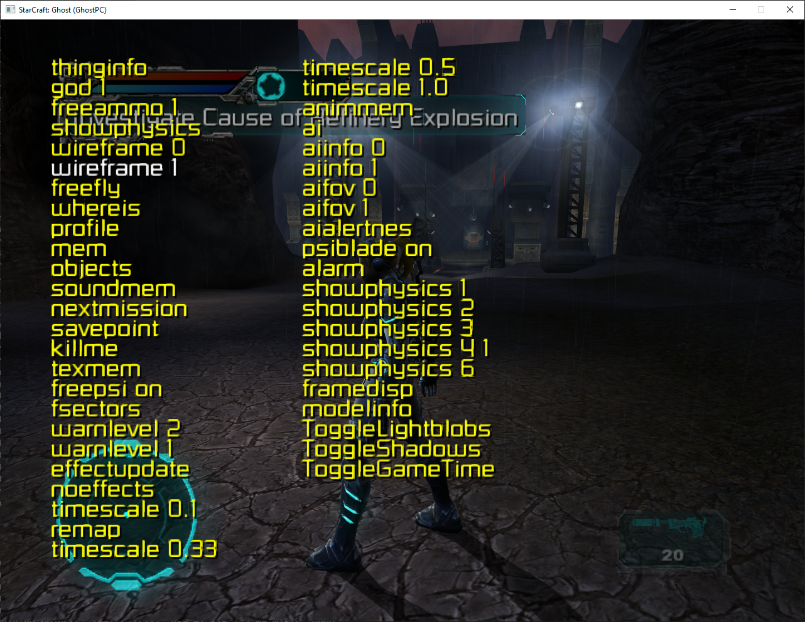
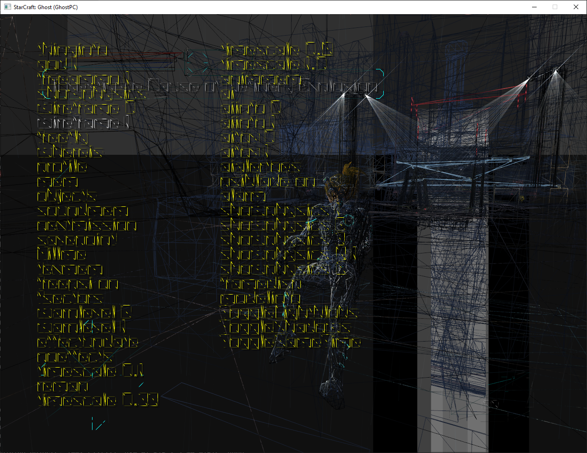
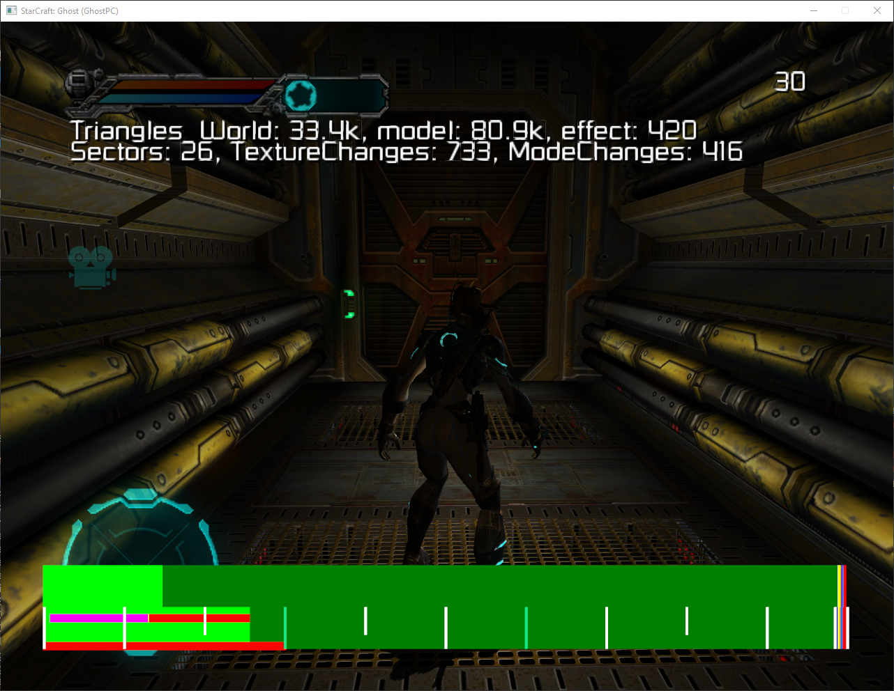
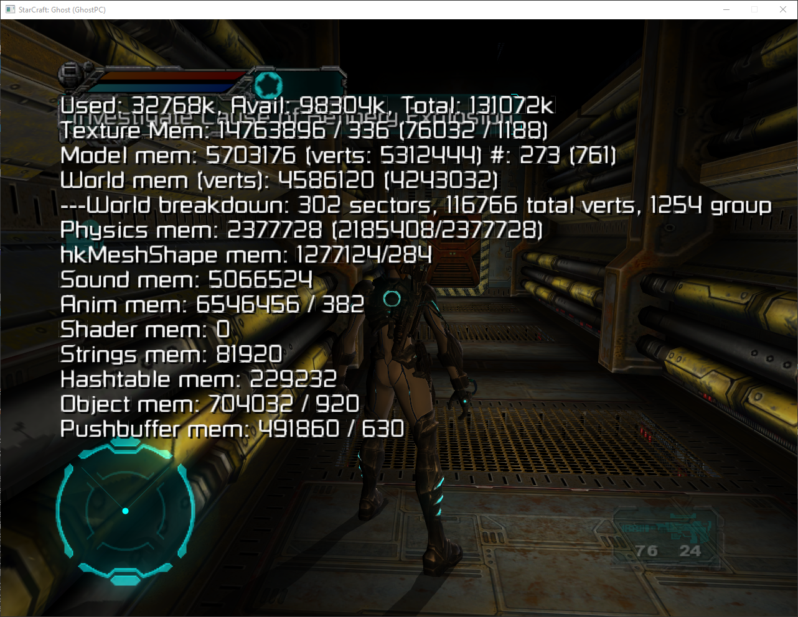
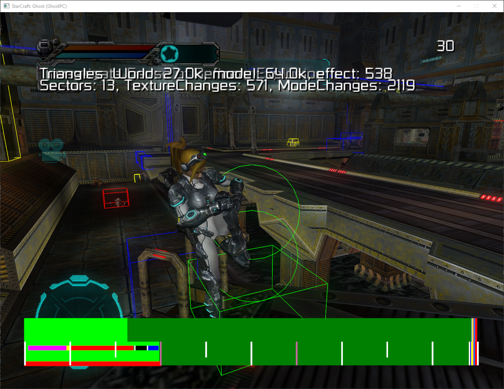
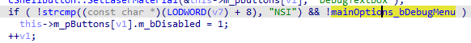
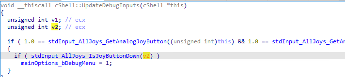

# Debug Tools

StarCraft: Ghost includes an in-game debug menu with gameplay commands,
rendering options, and diagnostic overlays. The menu was accessed during
investigation of the game's profile selection and controller input handling.

## Enabling the debug menu

The observed procedure requires two player profiles and a controller:

1. Create a player profile named `NSI`.
2. Create a second profile with a different name and use it to enter the game.
   The `NSI` profile appears to be inaccessible after creation.
3. During gameplay, press both analog sticks (left and right stick clicks) and
   the menu button simultaneously.

This combination was confirmed to open the debug menu.

> **Known limitation:** The two-profile setup was reported to cause additional,
> unspecified issues. The procedure above documents the observed behavior; it
> is not a verified workaround for those issues.

## Available tools

The menu exposes commands such as `god 1`, `freeammo 1`, `freefly`,
`nextmission`, and several `timescale` values, alongside diagnostic tools.
The screenshots below show examples of the available visualizations. They do
not establish the behavior of every menu command.

### Wireframe rendering

The menu includes `wireframe 0` and `wireframe 1`. The enabled view draws
wireframe geometry over the scene.

### Frame diagnostics

The menu includes `framedisp`. The captured frame diagnostics view shows
triangle counts for the world, models, and effects, as well as sector,
texture-change, and mode-change counts. A colored diagnostic bar appears
across the bottom of the screen.

### Memory information

The memory information overlay reports used, available, and total memory,
along with breakdowns for textures, models, world geometry, physics, sound,
animation, shaders, strings, hash tables, objects, and push buffers.

### Physics visualization

The menu includes `showphysics` and several numbered variants. The captured
view displays colored outlines and volumes around the player and scene
objects. The meaning of each numbered mode and color has not been established.

## Reverse-engineering findings

### Profile selection

`cShellProfileSelect::Init` references both the string `NSI` and
`mainOptions_bDebugMenu`. The decompiled code shows a profile-name comparison
against `NSI` and a check of the debug-menu flag before disabling a profile
button. This is consistent with the observed difficulty selecting the `NSI`
profile after creating it.

### Controller input

`cShell::UpdateDebugInputs` checks a combination of controller inputs and sets
`mainOptions_bDebugMenu` to `1` when the condition is satisfied. In-game testing
identified the combination as both analog stick clicks plus the menu button.

## Related project

[GhostPC](https://github.com/Tamamo-no-Bae/GhostPC), shared by developer
u/Gurluas, explores mapping and intercepting XBE/MAP files directly rather than
performing full recompilation. It provides related context for running and
investigating the game alongside work on xboxrecomp.